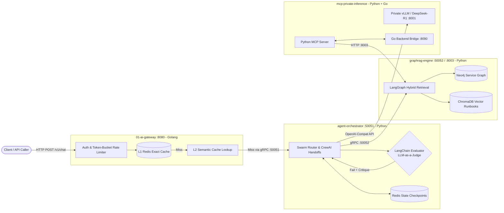

```markdown
# Aegis Agentic Platform

A polyglot, enterprise-grade **Agentic AI & LLM Infrastructure** monorepo built in **Golang** and **Python**. Each core capability is architected as an **independently runnable microservice** (with its own `Dockerfile`, dependencies, and test suite) that composes into a unified, low-latency AI mesh via **gRPC / Protobuf** and **Model Context Protocol (MCP)**.

---

## System Architecture



---

## Standalone Services Overview

| Service | Language | Core Responsibility | Ports | Standalone Command |
| --- | --- | --- | --- | --- |
| **`services/01-ai-gateway`** | Golang | Tenant API-key auth, per-tenant token-bucket rate limiting, L1 Redis exact cache, L2 semantic cache routing, and gRPC forwarding | `8080` (HTTP) | `make up-gateway` |
| **`services/mcp-private-inference`** | Python + Go | Standardized **MCP** server exposing diagnostics & GraphRAG tools, Go internal bridge, and air-gapped **vLLM (`DeepSeek-R1`)** client | `8090` (Go Bridge), `8001` (vLLM) | `make up-mcp` |
| **`services/graphrag-engine`** | Python | Hybrid **GraphRAG** powered by **LangGraph**, combining **Neo4j** structural service topology with **ChromaDB** semantic vector runbooks | `50052` (gRPC), `8003` (HTTP) | `make up-graphrag` |
| **`services/agent-orchestrator`** | Python | Deterministic **Swarm/CrewAI** multi-agent handoffs, Redis state checkpointing, and a **LangChain Evaluator-Optimizer** (LLM-as-a-Judge) safety loop | `50051` (gRPC) | `make up-orchestrator` |

---

## Setup Guide

### 1. Prerequisites

* **Docker** & **Docker Compose v2+** (required for containerized runs and backing stores: Redis, ChromaDB, Neo4j)
* **Go 1.22+** (for local `01-ai-gateway` and `go-bridge` development)
* **Python 3.12** & **`uv`** (recommended over Python 3.15 so compiled ML packages like `onnxruntime` and `grpcio-tools` install from prebuilt wheels)
* **Protobuf Compiler (`protoc`)** with `protoc-gen-go` and `protoc-gen-go-grpc` (only needed if regenerating gRPC stubs)

### 2. Local Python Environment Setup (Using `uv`)

Create a Python 3.12 virtual environment at the repo root (or per service) so all gRPC and ML dependencies resolve cleanly:

```bash
# Install uv if you don't have it
curl -LsSf [https://astral.sh/uv/install.sh](https://astral.sh/uv/install.sh) | sh

# Create and activate a Python 3.12 virtual environment
uv venv --python 3.12
source .venv/bin/activate

# Install service packages in editable mode
uv pip install -e services/mcp-private-inference
uv pip install -e services/graphrag-engine
uv pip install -e services/agent-orchestrator

```

### 3. Generate gRPC Stubs

Run this from the repository root to compile `contracts/proto/*.proto` for both Golang and Python:

```bash
make proto

```

### 4. Environment Variables

Default values work out of the box with Docker Compose. Override these if pointing to an external LLM endpoint (like Ollama on Mac or OpenAI):

| Variable | Default | Description |
| --- | --- | --- |
| `VLLM_BASE_URL` | `http://host.docker.internal:8001/v1` | OpenAI-compatible inference URL (e.g., `http://localhost:11434/v1` for Ollama) |
| `VLLM_API_KEY` | `local-vllm-airgapped` | API key for the inference endpoint |
| `VLLM_MODEL` | `deepseek-ai/DeepSeek-R1-Distill-Qwen-1.5B` | Model identifier served by vLLM/Ollama |
| `NEO4J_PASSWORD` | `password123` | Neo4j database password |
| `AUTO_SEED` | `true` | Automatically seeds sample Neo4j service topology and ChromaDB runbooks on startup |

---

## Makefile Reference

All orchestration, stub generation, and testing commands are standardized in the root `Makefile`:

| Command | Action |
| --- | --- |
| `make help` | Prints all available targets and descriptions |
| `make up` | Builds and starts **all 4 AI services** + Redis, ChromaDB, and Neo4j |
| `make up-gpu` | Starts the full platform **plus** the local NVIDIA GPU `vllm` container |
| `make down` | Stops and removes all containers across all profiles |
| `make logs` | Streams live logs from all running containers |
| `make up-infra` | Starts only the shared backing stores (`redis`, `chromadb`, `neo4j`) |
| `make up-gateway` | Starts only `01-ai-gateway` (+ Redis & ChromaDB) |
| `make up-mcp` | Starts only `mcp-private-inference` (+ Go backend bridge) |
| `make up-graphrag` | Starts only `graphrag-engine` (+ Neo4j & ChromaDB) |
| `make up-orchestrator` | Starts only `agent-orchestrator` (+ Redis) |
| `make proto` | Compiles `.proto` contracts into Go and Python gRPC stubs |
| `make test-all` | Runs Go (`go test ./...`) and Python (`pytest`) test suites across all services |

---

## How to Run the Projects

### Mode 1: Run the Full Platform Together (Docker)

```bash
# Start all 4 services and backing databases
make up

# Verify the gateway is healthy
curl http://localhost:8080/healthz

```

### Mode 2: Run Any Project Independently (Docker Profiles)

Each service can be booted in isolation with only its required dependencies:

```bash
make up-gateway       # Test auth, rate limiting & Redis caching
make up-graphrag      # Test Neo4j + ChromaDB hybrid retrieval on :8003 / :50052
make up-orchestrator  # Test Swarm/CrewAI + Evaluator loop on :50051
make up-mcp           # Test MCP server + Go bridge on :8090

```

### Mode 3: Run Locally Outside Docker (Active Development)

1. Boot only the databases:
```bash
make up-infra

```


2. Run each service in its own terminal:
```bash
# Terminal 1: GraphRAG Engine (gRPC :50052, HTTP :8003)
cd services/graphrag-engine && python -m src.grpc_server

# Terminal 2: Agent Orchestrator (gRPC :50051)
cd services/agent-orchestrator && python -m src.grpc_server

# Terminal 3: Golang AI Gateway (HTTP :8080)
cd services/01-ai-gateway && go run ./cmd/gateway

# Terminal 4 (Optional): MCP Go Bridge (:8090) & Python MCP Server
cd services/mcp-private-inference/go-bridge && go run main.go
cd services/mcp-private-inference && python -m mcp_server.server

```


---

## API Reference

### 1. Golang AI Gateway (`01-ai-gateway` — Port `8080`)

#### Authentication

All `/v1/*` endpoints require a valid tenant key via `X-API-Key` or `Authorization: Bearer <key>`.

* Demo keys: `aegis-dev-key-1` (`tenant-fintech-amex`), `aegis-dev-key-2` (`tenant-retail-wmt`)
* Rate Limit: `50 req/sec` (burst `100`) per tenant. Returns `429 Too Many Requests` with `Retry-After: 1` when exceeded.

#### `GET /healthz`

Health check endpoint.

```bash
curl http://localhost:8080/healthz
# Response: {"status":"ok","service":"01-ai-gateway"}

```

#### `POST /v1/chat`

Primary entry point. Checks L1 Redis exact cache $\rightarrow$ L2 Semantic Vector Cache $\rightarrow$ forwards misses via gRPC to `agent-orchestrator`.

**Request:**

```bash
curl -X POST http://localhost:8080/v1/chat \
  -H "Content-Type: application/json" \
  -H "X-API-Key: aegis-dev-key-1" \
  -d '{
    "prompt": "Why is PaymentGateway experiencing high P99 latency?",
    "use_graph_rag": true
  }'

```

**Response (`200 OK`):**

```json
{
  "answer": "PaymentGateway P99 latency spikes occur when the downstream FraudEngine gRPC connection pool saturates. Scale FraudEngine replicas via kubectl and increase gRPC max_concurrent_streams to 500.",
  "cache_tier": "MISS_LIVE_INFERENCE",
  "source_agent": "IncidentTriageAgent -> SRERemediationAgent [eval:pass]",
  "latency_ms": 842
}

```

*(Repeating the exact query returns `"cache_tier": "L1_REDIS_EXACT"` in `<2ms`.)*

---

### 2. Hybrid GraphRAG Engine (`graphrag-engine` — HTTP `:8003` / gRPC `:50052`)

#### `GET /healthz`

```bash
curl http://localhost:8003/healthz
# Response: {"status":"ok","service":"graphrag-engine"}

```

#### `POST /v1/retrieve`

Executes the LangGraph hybrid retrieval pipeline (Neo4j Cypher traversal + ChromaDB cosine similarity search + reranking).

**Request:**

```bash
curl -X POST http://localhost:8003/v1/retrieve \
  -H "Content-Type: application/json" \
  -d '{"query": "PaymentGateway P99 latency", "top_k": 3}'

```

**Response (`200 OK`):**

```json
{
  "merged_context": "### Structural Service Topology (Neo4j)\n- PaymentGateway -[CALLS {'protocol': 'gRPC', 'timeout_ms': 500}]-> FraudEngine\n\n### Relevant Runbooks & Docs (ChromaDB)\n- RUNBOOK-104: PaymentGateway P99 latency spikes...",
  "graph_facts": ["PaymentGateway -[CALLS {'protocol': 'gRPC', 'timeout_ms': 500}]-> FraudEngine"],
  "vector_chunks": ["RUNBOOK-104: PaymentGateway P99 latency spikes..."],
  "latency_ms": 34.2
}

```

#### gRPC Contract (`contracts/proto/graphrag.proto`)

* **RPC:** `aegis.graphrag.GraphRAGEngine/RetrieveContext(RetrieveRequest) returns (RetrieveResponse)`

---

### 3. Agent Orchestrator (`agent-orchestrator` — gRPC `:50051`)

#### gRPC Contract (`contracts/proto/gateway.proto`)

* **RPC:** `aegis.gateway.AgentOrchestrator/ProcessPrompt(PromptRequest) returns (PromptResponse)`
* **Flow:** Fetches GraphRAG context (if `use_graph_rag=true`) $\rightarrow$ Routes via Swarm (`IncidentTriageAgent -> SRERemediationAgent` or `ArchitectureAdvisorAgent`) $\rightarrow$ Saves checkpoints to Redis $\rightarrow$ Audits draft via LangChain Pydantic v2 Evaluator-Optimizer loop (max 2 retries).

---

### 4. MCP Server & Go Bridge (`mcp-private-inference` — Bridge `:8090`)

#### Go Backend Bridge HTTP API

* `GET /healthz` — Bridge health status
* `GET /internal/services/{service_name}/status` — Returns live service status, circuit-breaker state, and P99 latency:

```bash
curl http://localhost:8090/internal/services/PaymentGateway/status

```

#### Standardized MCP Tools & Resources (`mcp_server/server.py`)

| Type | Identifier | Description |
| --- | --- | --- |
| **Tool** | `tool_check_node_health()` | Returns host CPU, memory, and disk telemetry via `psutil` |
| **Tool** | `tool_inspect_backend_service(service_name)` | Queries the Go bridge (`:8090`) for live microservice & circuit-breaker health |
| **Tool** | `tool_query_architecture_graph(question)` | Queries `graphrag-engine` (`:8003`) for Neo4j topology and ChromaDB runbooks |
| **Resource** | `config://aegis/gateway-limits` | Exposes live AI Gateway rate limits and semantic cache thresholds |
| **Resource** | `config://aegis/inference-model` | Exposes active private vLLM model and air-gapped endpoint metadata |

---

## Testing

```bash
# Run all Go and Python unit tests
make test-all

# Or run tests for a single service
cd services/01-ai-gateway && go test -v ./...
cd services/graphrag-engine && pytest -v
cd services/agent-orchestrator && pytest -v

```

```

```